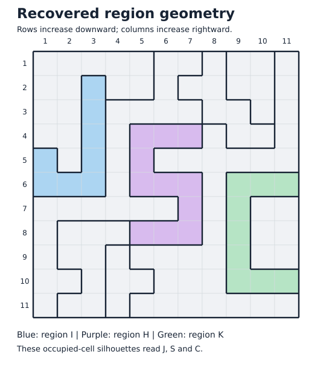
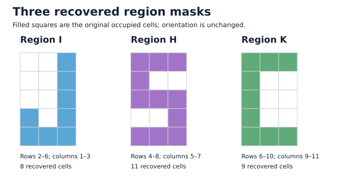
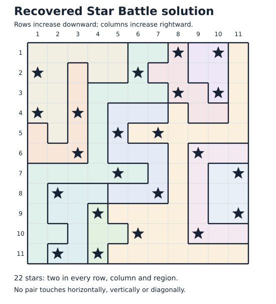

# VCD and region-geometry evidence

The original sample VCD contains two enabled input attempts of 121 bits each. Sampling `I` at rising edges of `clk` while `rst_n=1` and `enable=1` produces the captured bits below. The file has 312 rising clock edges in total.

Split each attempt into eleven consecutive 11-bit rows. Interpret columns 1–7 as a 7-bit ASCII value with column 1 carrying bit 0; columns 8–11 are zero in every row. Preserve the original row and attempt order. The exact result is **`The night sky awaits` followed by two spaces**. Thus the source message is mixed case; its uppercase rendering is a transcription choice.

| Attempt | Row | Eleven bits in capture order | Seven LSB-first bits | ASCII | Character | First–last rising-edge time (ps) |
| --- | --- | --- | --- | --- | --- | --- |
| 1 | 1 | `00101010000` | `0010101` | 84 / 0x54 | T | 45000–145000 |
| 1 | 2 | `00010110000` | `0001011` | 104 / 0x68 | h | 155000–255000 |
| 1 | 3 | `10100110000` | `1010011` | 101 / 0x65 | e | 265000–365000 |
| 1 | 4 | `00000100000` | `0000010` | 32 / 0x20 | SPACE | 375000–475000 |
| 1 | 5 | `01110110000` | `0111011` | 110 / 0x6e | n | 485000–585000 |
| 1 | 6 | `10010110000` | `1001011` | 105 / 0x69 | i | 595000–695000 |
| 1 | 7 | `11100110000` | `1110011` | 103 / 0x67 | g | 705000–805000 |
| 1 | 8 | `00010110000` | `0001011` | 104 / 0x68 | h | 815000–915000 |
| 1 | 9 | `00101110000` | `0010111` | 116 / 0x74 | t | 925000–1025000 |
| 1 | 10 | `00000100000` | `0000010` | 32 / 0x20 | SPACE | 1035000–1135000 |
| 1 | 11 | `11001110000` | `1100111` | 115 / 0x73 | s | 1145000–1245000 |
| 2 | 1 | `11010110000` | `1101011` | 107 / 0x6b | k | 1605000–1705000 |
| 2 | 2 | `10011110000` | `1001111` | 121 / 0x79 | y | 1715000–1815000 |
| 2 | 3 | `00000100000` | `0000010` | 32 / 0x20 | SPACE | 1825000–1925000 |
| 2 | 4 | `10000110000` | `1000011` | 97 / 0x61 | a | 1935000–2035000 |
| 2 | 5 | `11101110000` | `1110111` | 119 / 0x77 | w | 2045000–2145000 |
| 2 | 6 | `10000110000` | `1000011` | 97 / 0x61 | a | 2155000–2255000 |
| 2 | 7 | `10010110000` | `1001011` | 105 / 0x69 | i | 2265000–2365000 |
| 2 | 8 | `00101110000` | `0010111` | 116 / 0x74 | t | 2375000–2475000 |
| 2 | 9 | `11001110000` | `1100111` | 115 / 0x73 | s | 2485000–2585000 |
| 2 | 10 | `00000100000` | `0000010` | 32 / 0x20 | SPACE | 2595000–2695000 |
| 2 | 11 | `00000100000` | `0000010` | 32 / 0x20 | SPACE | 2705000–2805000 |

The `$version` field reads:

> Leave no stone unturned! But for this file, consider looking at it in a waveform viewer instead.

The `$date` field is **`Sat Dec 31 23:59:60 2016`**. The weekday is correct, and second 60 was a real UTC leap second: [IERS Bulletin C 52](https://datacenter.iers.org/data/16/bulletinc-052.txt) announces it explicitly, while [NIST's leap-second table](https://www.nist.gov/pml/time-and-frequency-division/time-realization/leap-seconds) lists 2016-12-31. These primary sources were checked on 2026-10-13. The VCD date is an embedded clue, not evidence that the file was created at that moment.

## Recovered silhouettes

The region masks come directly from `verification.json`. Keep their top-to-bottom and left-to-right orientation. Region I occupies rows 2–6 and columns 1–3 (8 cells); H occupies rows 4–8 and columns 5–7 (11 cells); K occupies rows 6–10 and columns 9–11 (9 cells). Their left-to-right silhouettes resemble J, S and C. Interpreting this as Jane Street Capital's initials is a visual inference. The extraction's arbitrary region labels are unrelated to that inference.

```text
Region I       Region H       Region K

..#               ###               ###
..#               #..               #..
..#               ###               #..
#.#               ..#               #..
###               ###               ###
```







Reproduce with Python 3.10+ (standard library only):

```text
python analyze_signals.py --vcd example_inputs.vcd --verification verification.json --out-dir evidence
```
