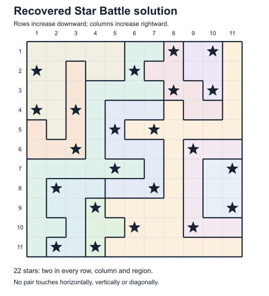
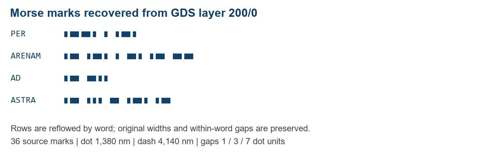
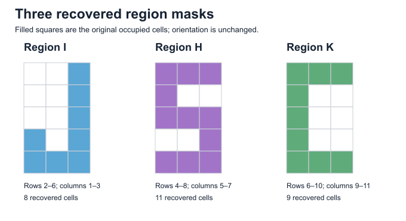

# Reproducible Reverse Engineering of the Jane Street 2026 ASIC Puzzle: Netlist Recovery, Unique Star Battle Solution, and Complete Easter-Egg Audit

**LOVE4KIMCHAEWON**  
AI-assisted reproducibility study · Technical report, not peer reviewed  
13 October 2026

## Abstract

This report reproduces Jane Street's 2026 ASIC puzzle after publication of the organizer's solution on 2 October 2026. It reuses Mubin Shaikh's MIT-licensed extractor and simulator, adds a standard-library GDS adapter, and solves the recovered Star Battle board with an independently implemented constraint search. Extraction recovers 942 standard cells, 1,794 combinational primitives, and 92 flip-flops. Validation includes 319 warm-up cases, 2,808 bit comparisons over 312 reference clock edges, deliberately invalid boards, and native-gdstk agreement. The board has one solution with 22 stars; simulation emits `(* TWO STARS *)`. An evidence audit recovers all six intended Easter eggs and diagnoses an additional floating-wire defect. This AI-assisted reproduction makes no claim of independent first discovery and states the limits of its two-valued, zero-delay model.

## 1. Introduction and provenance

The challenge asks solvers to recover connectivity and behavior from a GDSII layout and obtain its successful output string. The repository supplies an unsuccessful input/output waveform and a warm-up circuit with source, netlist, placement information, and layout [1, 2]. These paired artifacts permit extraction and behavioral checks.

The official results identify an 11-by-11 Star Battle checker [3]: exactly two stars per row, column, and region, with none touching diagonally or orthogonally. The output is mixed with board-dependent state, so overriding success does not establish correct reconstruction.

This study uses published analysis as prior knowledge and credits the extractor and simulator to Mubin Shaikh [4]. The adapter, board solver, orchestration, additional tests, and Easter-egg audit were prepared with AI assistance. This is a reproducibility report, not a new technique or an original contest solution.

Three source revisions fix the experiment: Jane Street's puzzle repository at `ffd53e0ba24e2fc1c1b12dc824e8eac5888c19a9`; Shaikh's tools at `1dc04232f333df5a06626d733403f2d86c009b23`; and the SkyWater HD cell library at `ac7fb61f06e6470b94e8afdf7c25268f62fbd7b1`. The puzzle GDS SHA-256 is `8913ea4be5367b484d5886c3c5f7608942b67544a0dbe364b17223503b8d851a`. The runner checks this digest before applying revision-specific register indices. Source data remain available from their upstream repository; reusable tools retain their original licenses.

## 2. Methods

### 2.1. Recovering a graph from layout geometry

The GDS retains named SKY130 cells and pin labels despite stripped internal net names. Connectivity can therefore be extracted between known cells without reconstructing transistors: placed pins sharing a conductor form a net.

The extractor decomposes Manhattan polygons into rectangles, transforms hierarchical geometry into global coordinates, and treats touching or overlapping rectangles on one conductor layer as connected. A spatial bucket index narrows candidate intersections. A union-find structure represents connected components. Contact and via shapes then merge the components on their two adjacent conductive layers. Finally, transformed pin labels and top-level port labels attach names to those components. Closed-interval overlap is necessary because two abutting rectangles may form one continuous conductor.

The conductive stack includes `li1` and `met1` through `met5`; bridges occupy 67/44 through 71/44 and must overlap conductors on both sides. Power and tie cells are preserved while physical fill is distinguished from logic. Replacing tie-high outputs with zero can disable a check despite matching rejected examples [3].

An API-compatible standard-library adapter reads the layout records needed by the unchanged extractor: units and GDS real numbers, references, polygons, labels, transformations, and two-point orthogonal paths with their end extensions. It rejects array references rather than approximating them. Separate native-gdstk extraction yields the same recovered representation; this validates the adapter for these files without making it a general GDSII reader.

### 2.2. Behavioral model and input protocol

Cell semantics come from SkyWater's official functional Verilog [5]. Combinational primitives are evaluated in dependency order; flip-flop D values are computed from the pre-edge state and committed simultaneously, followed by settling. Asynchronous reset/set is applied around transitions.

The zero-delay, two-valued model excludes analog effects and timing. Uninitialized or undriven values default to zero, a material assumption for the floating Easter-egg output signal.

Each board trial starts with active-low reset asserted and `enable` low for four cycles. After two released-reset cycles, `enable` is set high and 121 bits are presented on `I`, one per cycle. The order is row-major, starting at the top left of the recovered board. Input is then disabled and the eight output pins are assembled as `O[7:0]` for sixteen further cycles. The success trace is checked throughout readout.

### 2.3. Validation against known behavior

The warm-up checks `A + B = 496` for two eight-bit operands. Tests cover all fifteen successful pairs (`A = 241..255`, `B = 496 - A`), four rejection/boundary pairs, and 300 fixed-seed pseudorandom pairs. They are not exhaustive over all 65,536 operand pairs.

The puzzle's VCD is parsed into timestamp groups. Input changes and asynchronous reset are applied to the model; each clock transition from zero to one advances the circuit. At the post-edge boundary, known reference output bits and the known success bit are compared against the simulator. Unknown reference values are excluded rather than silently treated as zero. The two recorded input attempts each contain 121 accepted bits.

Additional tests exercise empty/full boards, count rejection by removing a star, and adjacency rejection by a four-cell swap preserving all row, column, and region totals. The last case tests behavior absent from the rejected reference inputs.

### 2.4. Region recovery and independent constraint search

Single-star probing recovers region membership: compare eleven accumulator pairs against an all-zero baseline while setting each of 121 board positions in turn. Every probe must change exactly one pair. The register indices are inherited from published analysis; membership is remeasured, but register classification is not independently discovered.

The board solver is independently implemented in the Python standard library and does not import the public SAT solver or its successful input. A row is represented by a pair of nonadjacent star positions. There are 45 such patterns for an eleven-cell row: all 55 unordered pairs minus ten adjacent pairs. Candidate domains are encoded as bitsets. Neighboring rows are compatible only if neither pattern occupies a column equal or adjacent to a star in the other row.

Propagation repeatedly removes row candidates lacking support in the neighboring row and bounds each column and region count. If a constraint cannot reach exactly two stars, the branch fails. Remaining row domains are searched by choosing the row with the fewest candidates. Search requests up to two solutions, distinguishing a unique result from a merely successful witness. Finding one solution while completing the remaining search proves uniqueness for the recovered mathematical board. It does not independently prove that arbitrary input protocols cannot reach the chip's success state.

## 3. Results

### 3.1. Extraction and behavioral validation

The recovered representation contains 942 retained standard-cell records, 1,794 combinational primitive entries, and 92 flip-flops. Extraction processes 92,001 conductor/contact/via rectangles. All 2,801 inspected pin entries resolve to one net; no inspected pin is missing, and no via fails the two-sided connectivity audit. Native gdstk and the standard-library reader produce equal extracted representations for this source revision.

All 319 warm-up tests pass. Reference-waveform replay covers 312 clock rising edges, comparing 2,496 output bits and 312 success bits, for 2,808 total comparisons. There are zero mismatches. These are functional and connectivity checks, not physical sign-off or an exhaustive equivalence proof.

The board search visits 1,098 search nodes, performs 1,964 propagation passes, and rejects 889 nodes. It returns one solution and exhausts the remaining search. The solution has 22 stars, with two in every row, column, and region and no touching pair. Table 1 summarizes the main measurements; the complete machine-readable record is `verification.json`.

| Check | Measured result |
|---|---|
| Recovered standard cells / combinational primitives / flip-flops | 942 / 1,794 / 92 |
| Geometry rectangles / failed vias | 92,001 / 0 |
| Single-net pin entries / missing entries | 2,801 / 0 |
| Warm-up cases | 319 passed |
| Reference clock edges / compared bits / mismatches | 312 / 2,808 / 0 |
| Board solution count / stars | 1 / 22 |
| Solver nodes / propagation passes / rejected nodes | 1,098 / 1,964 / 889 |
| Successful readout | 15 answer bytes plus a zero byte; success high for 16 cycles |

*Table 1. Local measurements from the reproduction, not measurements imported from a published solver.*

### 3.2. Winning input and output

The recovered winning board is shown below. A star corresponds to input one; a period corresponds to zero.

```text
.......*.*.
*....*.....
.......*.*.
*.*........
....*.*....
..*.....*..
....*.....*
.*....*....
...*......*
.....*..*..
.*.*.......
```

Concatenating the eleven rows yields the 121-bit input; the line breaks below are visual only:

```text
0000000101010000100000000000010101010000000000001010000
0010000010000001000001010000100000001000000100000100100
01010000000
```

The original extracted circuit, without changing its success logic or output generator, emits hexadecimal bytes `28 2A 20 54 57 4F 20 53 54 41 52 53 20 2A 29`, followed by `00`. These decode to `(* TWO STARS *)`. Success is one on all sixteen observed readout cycles. The agreement simultaneously validates the board, the input ordering, and the output generator for this execution.



*Figure 1. Recovered region map and unique winning board. Stars denote ones in the row-major serial input; all eleven regions contain two stars.*

## 4. Complete Easter-egg audit

The organizer identifies six intended Easter eggs and an additional layout defect [3]. The categories below follow that inventory rather than counting each failure message separately. The winning OCaml-comment string is reported as the answer, not as an extra intended egg.

| Intended egg | Recovery method and evidence |
|---|---|
| Hidden sentence in the reference inputs | Two 121-bit attempts decode to `The night s` and `ky awaits  `: mixed case, 22 characters total, with final ASCII values 32 and 32. Each 11-bit row carries seven least-significant-bit-first ASCII bits followed by four zeros. |
| VCD date and version hints | The date is `Sat Dec 31 23:59:60 2016`. Its second 60 matches a real UTC leap second [6]. The version field suggests viewing the waveform. |
| Morse marks beneath the die | Layer 200/0 contains 36 marks: 21 dots and 15 dashes. Measured widths and 1/3/7-unit spacing decode to `PER ARENAM AD ASTRA`. |
| Alternative failure outputs | Simulate an empty board, a full board, a count-valid board with touching stars, and ordinary rejected input. They select `EMPTY SKY`, `BIG BANG`, the touching-stars hint, and `TRY AGAIN`. |
| Metal-layer logo | Layer 69/20 contains 1,366 squares, each 300 by 300 nm, on a 57-by-57 grid isolated from routing. Adjacent logo pixels can abut. Rendering the source squares depicts the Jane Street logo. |
| Region-map lettering | Actual region masks I, H, and K resemble J, S, and C from left to right without rotation or reflection, supporting the organizer's `JSC` interpretation. |

*Table 2. Six intended categories verified through the source VCD, recovered geometry, region membership, and circuit simulations. The exact decodes and coordinates accompany the report as machine-readable evidence.*

The ASCII reconstruction preserves capture order. Attempt one spans accepted samples from 45,000 to 1,245,000 ps; attempt two spans 1,605,000 to 2,805,000 ps. The source date is an embedded clue, not evidence of the file's actual creation time. IERS Bulletin C 52 explicitly announced the extra UTC second at the end of 2016 [6].

The Morse strip lies at `(1330, -52720)` to `(198670, -50000)` nm. Dots are 1,380 nm wide, dashes 4,140 nm wide, and all marks are 2,720 nm high. Gaps of one, three, and seven dot widths separate symbols, letters, and words. These measured dimensions provide the decoding rule, rather than relying only on a recognizable phrase.

The logo's bounding box is `(34900, 35200)` to `(52000, 52300)` nm, measuring 17.1 micrometres per side. Its lattice pitch is 300 nm. Matrix row zero is the highest GDS y coordinate, and column zero is the lowest x coordinate. No non-logo met2 or neighboring via bounding box intersects this area in the audited flattened geometry.

For the lettering, one-based region I spans rows 2–6 and columns 1–3, region H rows 4–8 and columns 5–7, and region K rows 6–10 and columns 9–11. They contain 8, 11, and 9 cells respectively. Cropping actual occupied-cell masks gives J-, S-, and C-like silhouettes. This is a visual inference from real memberships; no replacement letters or rotation are used.

The failure-output tests give `EMPTY SKY` for all zeros, `BIG BANG` for all ones, and `TRY AGAIN` after removing one solution star. For the adjacency-specific case, we toggle zero-based cells `(0,0)`, `(0,7)`, `(1,0)`, and `(1,7)`. Every row, column, and region still contains exactly two stars, but cells `(1,7)` and `(2,7)` touch. Success stays zero, establishing that the model has not accidentally disabled the adjacency check.

The raw simulation renders the touching-stars hint as `TWO"NOT TOUCH`. Undriven net 71909 feeds `A1` on instances 6991 (`sky130_fd_sc_hd__a31oi_2`) and 7091 (`sky130_fd_sc_hd__a311o_2`), at `(177560, 92480)` and `(181700, 92480)` nm. The organizer acknowledges an unconnected signal in this path [3]. Diagnostic constant assignments show sensitivity of the rejected-board output (Table 3), while the winning output remains unchanged. Neither assignment repairs the missing connection or predicts its analog voltage; the intended signal could have been dynamic.

| Diagnostic value of net 71909 | Touching-board readout | Touching-board success | Winning readout / success |
|---|---|---|---|
| 0, the simulator default | `TWO"NOT TOUCH` | 0 for 16 cycles | `(* TWO STARS *)` / 1 for 16 cycles |
| 1, forced for diagnosis | `TWO NOT TOUCJ\x02\x10` | 0 for 16 cycles | Same 15 answer bytes plus zero / 1 for 16 cycles |

*Table 3. Binary sensitivity experiment. `\x02` and `\x10` denote nonprintable byte values 2 and 16, not literal backslash characters. Forcing one does not restore the intended phrase.*



*Figure 2. Source layer-200 Morse marks reflowed by word for readability; measured widths and within-word gap lengths are preserved. The continuous original strip is provided in the geometry evidence.*


*Figure 3. The 57-by-57 met2 lattice reconstructed from 1,366 source squares, with highest GDS y at the top.*



*Figure 4. Actual region memberships yielding J-, S-, and C-like silhouettes. Arbitrary region labels I, H, and K identify the recovered masks.*

## 5. Discussion and limitations

The checks provide complementary evidence: source-backed warm-up behavior, reference temporal alignment, native-reader parity, independent board search, rejection tests, and a board-dependent successful readout.

The extractor and simulator reuse published code. Reader parity cannot prove their common extraction algorithm universally correct. Warm-up rejection cases and the two rejected VCD boards do not exhaust either circuit. Mathematical uniqueness concerns the recovered board rules and fixed 121-bit protocol, not arbitrary reset, enable, or clock sequences.

Hardcoded accumulator indices depend on source revision, cell order, and extraction numbering. The GDS digest guard prevents applying them silently to another layout; generalization would require automatic register classification.

The limited GDS adapter is not a production parser. The zero-delay Boolean model likewise differs from four-valued Verilog, timing-aware or analog simulation, and physical silicon. Its floating-net convention must remain visible.

The Easter-egg audit also combines different kinds of evidence. The input sentence and header are exact text decodings; the failure strings are circuit observations; Morse is a geometric decoding with a spacing rule; the logo and `JSC` depend partly on visual recognition. Providing raw counts, coordinates, and rendered artifacts makes those interpretations inspectable and keeps them distinct from claims about circuit behavior.

## 6. Reproduction and availability

The Python 3.10+ package uses the standard library. Obtain the pinned original files upstream and invoke the root runner:

```text
python run_all.py --puzzle-dir data/asic-puzzle-2026
```

This runs the main reconstruction in `src/reproduce.py`, all six intended Easter-egg checks, and the floating-net diagnostic. It exports recovered JSON/Verilog netlists, input, board, answer, audit data, and validation records.

The release stores core records under `results/`, including `verification.json`, `netlist.json`, `recovered_netlist.v`, `input_bits.txt`, `solution.txt`, and `answer.txt`; it also includes Easter-egg evidence and rendered figures. Original GDS/VCD are obtained upstream. MIT/Apache-2.0 notices and attribution accompany the code. The package README records source acquisition and invocation details.

Repository: [jane-street-asic-2026-reproduction](https://github.com/LOVE4KIMCHAEWON/jane-street-asic-2026-reproduction).

## References

[1] Singhani, A., and Devlin, B. [**Can you reverse engineer an ASIC?**](https://blog.janestreet.com/can-you-reverse-engineer-an-asic/) Jane Street Blog, 5 August 2026.

[2] Jane Street. [**asic-puzzle-2026**](https://github.com/janestreet/asic-puzzle-2026). Original GDS, reference waveform, and warm-up source artifacts. Revision `ffd53e0ba24e2fc1c1b12dc824e8eac5888c19a9`.

[3] Devlin, B., and Singhani, A. [**Results from the ASIC puzzle**](https://blog.janestreet.com/asic-puzzle-results/). Jane Street Blog, 2 October 2026.

[4] Shaikh, M. [**asic-puzzle-2026-solution**](https://github.com/shaikhmubin02/asic-puzzle-2026-solution). MIT-licensed extraction, simulation, and published analysis. Revision `1dc04232f333df5a06626d733403f2d86c009b23`.

[5] The SkyWater PDK Authors. [**skywater-pdk-libs-sky130_fd_sc_hd**](https://github.com/google/skywater-pdk-libs-sky130_fd_sc_hd). Functional Verilog cell models, Apache-2.0. Revision `ac7fb61f06e6470b94e8afdf7c25268f62fbd7b1`.

[6] International Earth Rotation and Reference Systems Service. [**Bulletin C 52**](https://datacenter.iers.org/data/16/bulletinc-052.txt). 6 July 2016. Announces the positive leap second at the end of December 2016.
